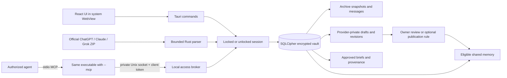

# Architecture and decisions

## Runtime boundaries

The GUI is the only process owning an unlocked database connection. The MCP bridge never receives the password/key and cannot unlock storage. Its requests pass through the same backend policy as local context previews. The local socket is not an internet endpoint.

## Source map

| Module                                            | Responsibility                                                                                                |
| ------------------------------------------------- | ------------------------------------------------------------------------------------------------------------- |
| `src/VaultGate.tsx`                               | Password gate, status, owner activity, lock-event unmount                                                     |
| `src/App.tsx`                                     | Archive, search, branches, imports, privacy, navigation                                                       |
| `src/Memory.tsx`, `Briefs.tsx`                    | Curation and explicit review                                                                                  |
| `src/Agents.tsx`, `Backup.tsx`                    | Consent, clients, preview, encrypted backups                                                                  |
| `src-tauri/src/desktop.rs`                        | Tauri commands, startup, private directory, exclusive app-instance lock                                       |
| `crypto.rs`                                       | Fixed-format Argon2id/SQLCipher configuration                                                                 |
| `db.rs`, `schema.sql`                             | Persistence, migrations, FTS, backup and import transactions                                                  |
| `import.rs`, `provider_import.rs`, `model.rs`     | Bounded ZIP normalization and branch graph                                                                    |
| `memory.rs`, `briefs.rs`, `privacy.rs`            | Derived knowledge and eligibility predicates                                                                  |
| `session.rs`, `mac_lock.rs`                       | Connection ownership, idle timer and native notifications                                                     |
| `client_config.rs`                                | Transactional registration and client-specific JSON/TOML settings                                             |
| `agents.rs`                                       | Client credentials/scopes and tool policy                                                                     |
| `broker.rs`                                       | Bounded authenticated Unix socket requests                                                                    |
| `mcp.rs`                                          | Official rmcp SDK stdio tool server                                                                           |
| `curation.rs`, `curation.sql`, `curation_jobs.rs` | Provider-private contributions, evidence versions, revision/retry safety, publication and resumable manifests |
| `src/Curation.tsx`                                | Owner workspace, batch review, edit/history/withdrawal and optional publication rules                         |

## Data model

- **conversations:** provider-scoped ID, platform, title, timestamps, private/sensitive flags, most recently imported raw JSON.
- **messages:** provider-scoped ID, conversation FK, role/content/time, parent/branch/position, active and sensitive flags.
- **archive_snapshots:** unique SHA-256 hash of original conversation JSON, conversation FK, raw JSON and import time; repeat identical imports do not duplicate snapshots.
- **memory:** kind, editable content, source message FK, had-source marker, approval/privacy/sensitivity and timestamps. The marker preserves fail-closed behavior if a source disappears.
- **briefs:** title/content, approval/privacy/sensitivity, updated time.
- **brief_sources:** brief FK, memory FK (SET NULL on deletion), reviewed memory timestamp. Null source or version mismatch blocks sharing.
- **agent_clients / agent_scopes:** client identity and SHA-256 bearer-token hash; owner-bound provider and curation grant. Legacy broad source access is downgraded during schema-4 migration.
- **curation_notes / curation_sources:** provider-owned contributions, archive/session origin, current revision, conflicts/sensitivity/withdrawal and cumulative source IDs/versions.
- **source_versions:** monotonically advanced evidence versions, including tombstones that prevent removed/reinserted IDs silently restoring old eligibility.
- **curation_revisions / curation_requests:** full encrypted revision snapshots with author client IDs, and request hashes/results for idempotent retry.
- **curation_policy / curation_publications:** per-provider archive/session automatic-publication switches and the released revision/basis. Both switches default off. Published contributions use the existing memory delivery layer.
- **curation_jobs / curation_job_sources / curation_processed_sources:** stable source manifests, ordinal checkpoints and acknowledged evidence for incremental processing. No model execution or scheduling lives here.
- **curation_blocked (view):** current exclusion predicate for conflicts, sensitivity, withdrawal and missing/restricted/foreign/stale evidence.
- **tags/conversation_tags:** schema reserved; no editing UI yet.
- **search_index:** encrypted FTS5 text, rebuilt for the affected ID set once per import transaction; a memory-only temporary table avoids repeated full-table scans.

Schema version 2 added the source marker and curated layers. Schema version 3 rescans existing content with current privacy rules and resets previous approvals once. Schema version 4 adds curation tables and provider grants, preserves existing manual approvals and downgrades old broad chat grants to shared-only. Encrypted backups retain manual approvals and complete curation data/history; current backups use schema 6 as described below. In-app restore/password rotation removes clients and resets automatic-publication rules before activation. Reject newer unknown schema versions. Encryption format 1 is separately defined in `crypto.rs`; schema upgrades must not silently change key derivation.

## Decisions and tradeoffs

### Native Tauri shell

Rust owns imports, SQL, crypto, permissions and local sockets. React supplies an approachable editor using the macOS WebView. No Electron runtime or web-hosted vault. Production assets are bundled; CSP blocks arbitrary network requests and executable imported HTML.

### Official export snapshots

Avoid credentials and live capture. Repeated imports merge stable provider IDs while preserving manual privacy and earlier branches. JSON snapshots provide future reprocessing evidence. A newer import can contain older provider data; “latest” currently means import order, not a historical conflict-resolution algorithm. Large imports run outside the UI thread but do not yet expose progress/cancellation.

### Encrypted SQL rather than encrypted text fields

Full database encryption also protects indexes and metadata stored inside the database. Established SQLCipher handles page authentication/IVs. Argon2id hardens the chosen separate password. No custom encryption primitive. Refer to SECURITY.md for limits and format parameters.

### GUI owns unlock state

A stand-alone agent opening the database would need a password, saved key or another secret-unlock mechanism. Instead, the GUI stays open and owner-unlocked; clients use scoped bearer credentials that cannot decrypt a copied database. This sacrifices unattended access intentionally.

### Reviewed source chains

Raw history is evidence, not approved memory. Manual saves always clear approval. Agent writes create a new private revision, then optionally release it only under the owner’s already enabled narrow policy; every release records its basis. Owner edits always stay private until reviewed. The owner-only review command returns persisted content, current supporting notes and a snapshot hash; a separate approval command rechecks that snapshot under the session mutex. MCP has access to neither command. Memory list tools serialize a dedicated response without archive provenance. Schema-v3 upgrade rescans stored content and clears old approvals once. Notes and briefs require approval and retain provenance. Eligibility is computed at query time to reflect later privacy/source changes. A brief is not silently rewritten by an agent or automatically approved after changing a source.

### Selected plaintext sharing

`src/Sharing.tsx` selects owner-visible notes/briefs and displays the complete payload. `sharing.rs` assembles at most 50 selected items and 128,000 UTF-8 bytes, excludes ineligible items and omits archive IDs/titles/source text. Exclusion metadata is separate from exported Markdown. A review hash binds item order, saved approval/provenance snapshots and final bytes; a session generation binds the unlock. Copy/save recompute before any side effect, while the session mutex remains held. Mac clipboard delivery uses NSPasteboard, not a separately queued frontend clipboard write. File creation requires a new `.md` path and mode 0600. The owner-only commands are not MCP tools.

An idempotently installed SQLite trigger invalidates linked memory approvals and advances their version when imported message text/role changes. This also blocks briefs that reviewed the previous memory version. Same-content reimports preserve approval. The trigger/index add no columns and do not alter the schema version or encryption format; they are installed when opening existing supported vaults as well as new ones.

### Local transport with explicit sharing

The bridge uses standard MCP stdio, then an owner-only Unix socket internally. Named credentials enable revocation and optional matching-provider raw-chat/curation scope. Generic clients stay shared-only. Provider isolation is enforced in the broker-facing backend, not inferred from a client-provided model name. This binds credentials, not the actual identity of the model holding them. A same-user malicious process remains in the threat model; filesystem permissions alone do not isolate it. Remote HTTP/OAuth service access is not implemented.

### Backup before convenience

Export a fresh encrypted database, verify it, then publish without overwrite. Existing files are preserved. Restore and password change prepare a separate verified generation, preserve the previous vault, then atomically publish a small active-directory selector. No hidden cloud recovery or password reset exists. Do not add silent plaintext recovery copies.

## Important failure behavior

- Wrong password/corruption never triggers a new empty vault over an existing file.
- Invalid ZIP/tree aborts that ZIP's transaction.
- Lock during import prevents commit through a generation check.
- Locked, sharing-off, invalid-token and insufficient-scope MCP calls fail.
- Missing/private/sensitive sources and stale brief approvals fail closed.
- Backup target collision never overwrites it.
- A failed old-file cleanup preserves the verified encrypted migration result.

Tests and pending validation are documented in AGENT_REVIEW.md. No remote AI provider, embedding pipeline, or synchronization service is present.

## Explicit sensitivity reclassification

Current rules distinguish structured/labeled phone numbers from bare timestamps and distinguish assigned credentials from general technical discussion. Existing stored restrictions persist until the owner previews and applies a recheck. The backend computes a deterministic content/flag snapshot, revalidates it, updates all classifications in one transaction, preserves manual privacy and provenance, and clears memory/brief approvals when anything changes. The session wrapper disables sharing before applying, including on failure. Reimports retain existing sensitivity so they cannot bypass this review path. No schema or encryption-format change is required.

Build identity (package version, source revision/local-change marker, build time and profile) and storage mode are exposed only to the local owner UI, including the locked screen. Test storage requires the explicit debug-only override; release builds always use ordinary application storage. Displaying a release profile does not claim Developer ID signing or notarization.

## Vault replacement and archive retention

`lifecycle.rs` owns preparation, active-path resolution and publication. Existing installations without a selector keep their root database. Restore copies a standalone encrypted backup into a mode-0700 generated directory; it rejects non-empty source journals and never modifies the chosen backup. Password change authenticates the current password read-only, then uses the encrypted backup path with a fresh salt/new key. Both validate integrity/schema/relationships, remove client registrations, checkpoint/flush, and retain a digest of the prepared bytes. The session stores no password in its prepared state.

Preparation stops sharing and binds the active path, session generation and SQLite connection change counter. Commit rechecks them and the prepared digest, reopens/verifies with the supplied password, flushes the new generation, closes the old session and atomically renames a flushed selector into place. The prior database and matching journals remain where they were. Publication failure before rename retains the original selection; directory-sync failure after rename returns a completed-with-warning result. Malformed selectors and missing generation targets fail closed; a post-publication layout marker also prevents fallback to the old root database if the selector is lost. Normal resolution never chooses an older generation implicitly. Pending copies are discarded on cancel/lock or stale apply where cleanup is possible; abrupt termination can leave unpublished encrypted copies. Older binaries cannot interpret the new layout and must not be used after switching.

`retention.rs` previews deletion under a session-bound change counter. Conversation deletion transactionally removes FTS entries, raw snapshots, messages and conversation/tag links, resets linked memory approval, and retains missing-source markers. Old source IDs cannot silently reattach after reimport. Snapshot cleanup removes only snapshots whose digest differs from the latest imported raw JSON; current JSON, all message branches and curation remain. Neither operation purges external backups or retained vault generations. Both stop live sharing on apply and reject stale reviews.

## Startup and renderer recovery

The HTML document includes a local loading card and a small standalone recovery script before the React application loads. A small bootstrap imports the React renderer dynamically and catches module-load failure. The loading card offers retry after ten seconds or a script/import failure. Rendering reveals the app and cancels the bootstrap fallback; a React error boundary hides failed content and requests a backend lock before enabling reload. Exceptions are not included in the recovery UI or caught-error logs.

The native process separately watches for the first bootstrap-ready signal. After fifteen seconds without one, it offers a native retry/close dialog, covering failure to load the document itself. It checks readiness again before acting on a delayed dialog response. A retry starts another bounded wait; successful startup disables this initial-load watchdog. Main-page navigation locks the session, revokes the current sharing session and discards prepared operations, so an interface reload does not preserve unlocked access. No database is decrypted during normal startup.

Optional debug startup tracing prints only fixed phase labels and monotonic elapsed milliseconds to the local process output. Release builds do not emit these diagnostics. Timing of external UI automation attachment is recorded separately from native startup.

## Bounded reader and curation rendering

The native reader mounts at most 20 matching messages per page. Memory and brief views mount 25 matching cards. Filters run before slicing, and changing a filter resets the page; shrinking a collection clamps the current page. Navigation keeps a readable result range and keyboard focus at the page controls. Very long messages (over 12,000 UTF-16 code units) initially show a 2,000-unit plain-text preview, with explicit full Markdown expansion. Original stored text and the memory editor input remain complete. Images, links and raw HTML remain inert in Markdown.

Conversation search covers all loaded messages in the selected branches, including collapsed text. Brief search covers titles and bodies. The brief editor searches all eligible approved source memories, displaying up to 50 matching options and explaining how to refine the search. Search inputs disable spelling correction/capitalization so macOS does not silently rewrite technical identifiers.

These are render limits, not database paging or a memory-use guarantee. Existing desktop commands still return all messages for the selected conversation and all memory/brief rows. SQL paging, indexed note search, maximum-size individual Markdown expansion and much larger collections require separate profiling. These existing render limits are independent of the schema-4 curation workspace. Curation lists use a bounded 30-item owner page, agent note responses have a byte budget, source reads are chunked and source manifests are paged; see MCP for limits.

## Curation transactions and model boundary

A write authenticates the client, derives its provider scope, verifies current source versions and expected contribution revision, and checks the retry key. The transaction saves the contribution, cumulative source references, complete revision, any permitted publication and its receipt together. A changed payload cannot reuse a key; an exact retry returns its original receipt, not a statement that the item is still shared. Publication is reevaluated on later delivery. Owner batch release hashes complete selected content and current eligibility; stale or partially ineligible batches fail atomically.

Raw search, source reads, private notes/history, jobs, privacy writes and revisions all enforce the same provider grant. Shared context packs include eligible summaries/briefs only, even for source-enabled clients. Shared payloads expose provider, revision, archive/session origin and publication basis, without raw IDs/titles or private session labels. A reference envelope reduces ambiguity; it cannot make model instructions embedded in prose harmless.

Evidence versions advance on meaningful content, role, parent/branch, active-path, timestamp or source-privacy changes. Import updates only actually removed/changed active-path rows, so identical imports do not create false invalidation. Missing/restricted/stale evidence blocks downstream memory, briefs and selected exports. Clearing privacy later does not resurrect an old released source version.

A job snapshots eligible unacknowledged source IDs/versions in a stable order. The client reads bounded pages/chunks, saves notes, then acknowledges progress using an expected job revision. New jobs discover changed/new/unacknowledged sources, including IDs sorting before earlier cursors. Checkpoints attest only that the agent advanced them, not semantic coverage. All model reasoning, continuation, budget and scheduling remain in the external client. Cloud use is optional; there is no model/API integration in the vault and no implemented local-model role.

## Additional providers and schemas 5–6

The ZIP boundary detects recognized filenames and validated record structures, then normalizes Claude/Grok text into the existing iterative tree parser. It retains each original conversation JSON, assigns explicit stored provider identity and uses provider-qualified IDs. ISO/Mongo timestamps use the already locked Chrono dependency; no library version changed. See PROVIDERS for limits, omitted fields and branch fallback behavior.

Schema 5 rebuilds only the three constrained provider tables (`agent_scopes`, `curation_policy`, `curation_notes`) inside a transaction to add Claude. For v4, foreign-key actions are disabled only on the unopened local connection during the standard table-rebuild sequence, checked before commit and reenabled before use. Child history/evidence/publication/job records and existing grants/policies are retained; a new Claude policy starts off. Failed migration returns an error. New/older vaults create the expanded tables directly, retaining the earlier legacy-grant downgrade. Schema 6 also rebuilds `curation_jobs` with the Claude constraint, preserving its source manifests. The v4 path performs both rebuilds in the same transaction; already-v5 vaults need only the job-table rebuild. Regressions for both prior versions verify successful Claude job creation after upgrade. Backups carry schema 6. Encryption format and password derivation are unchanged.

Current credentials still bind one provider. Optional cross-provider delegation is approved future product scope, requiring explicit source grants and a distinct delegated ownership model; it is not activated by this migration or these imports.
